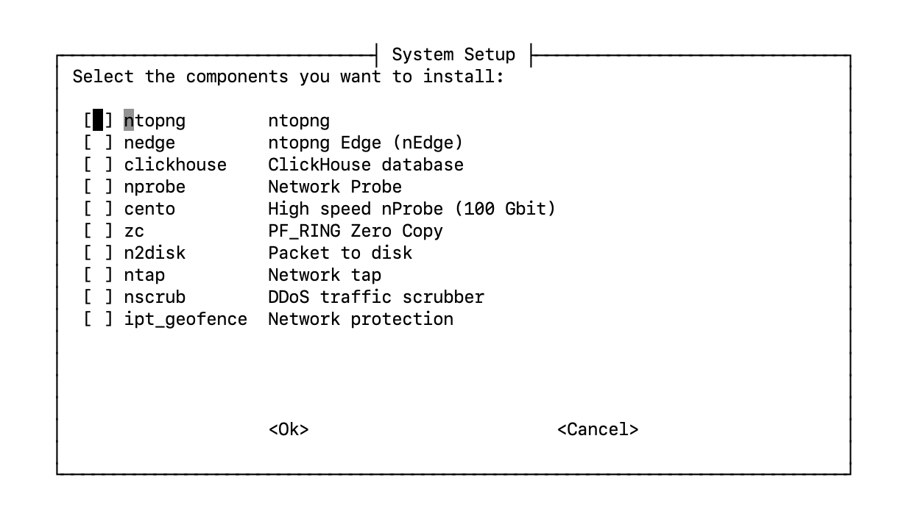

# Introduction
This repository contains various package installations tools
- ```quick_install.sh``` is used to install packages in a platform independent fashion. Example
- ```ntop-installer``` wizard that simplifies packages installation using a textual wizard



## Quick ntop Package Installation

If you want to install development packages do
- Ubuntu/Debian
```
apt update
apt -y install curl
/bin/bash -c "$(curl -fsSL https://raw.githubusercontent.com/ntop/package-installer/refs/heads/main/quick_install.sh)"
```
- RedHat/RockyLinux - FreeBSD
```
/bin/bash -c "$(curl -fsSL https://raw.githubusercontent.com/ntop/package-installer/refs/heads/main/quick_install.sh)"
```

If you want to install stable packages do
- Ubuntu/Debian
```
apt update
apt -y install curl
/bin/bash -c "$(curl -fsSL https://raw.githubusercontent.com/ntop/package-installer/refs/heads/main/quick_install.sh)" -- -s
```
- RedHat/RockyLinux - FreeBSD
```
/bin/bash -c "$(curl -fsSL https://raw.githubusercontent.com/ntop/package-installer/refs/heads/main/quick_install.sh)" -- -s
```
